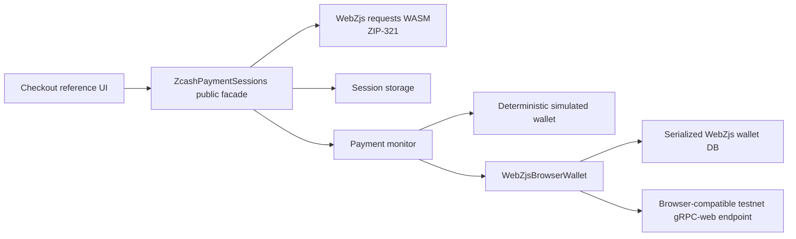

# Zcash Payment Sessions

Zcash Payment Sessions provides durable application-level payment sessions backed by ZIP-321
request generation and exact received-output observation from WebZjs.

## Reproducible WebZjs setup

The repository does not depend on a sibling checkout or on published WebZjs packages. The
bootstrap script creates an ignored `.deps/WebZjs` checkout at the exact pinned commit, applies
the tracked compatibility patch, builds only `webzjs-requests` and `webzjs-wallet`, verifies the
generated package names and versions, and installs the local packages with `npm ci`.

Prerequisites:

- Node.js `22.12.0` or newer (the current Vitest release requires Node 22.12+, 24.x, or 26.x)
- npm
- Git
- `clang`
- `just`
- `wasm-pack`
- `rustup` and `cargo`
- Rust nightly `nightly-2025-01-07` with `wasm32-unknown-unknown` and `rust-src`

The script never changes the global Rust default and never invokes `sudo`. If a prerequisite is
missing, it stops with the exact local installation command to run.

From a clean clone:

```sh
npm run bootstrap:webzjs
```

The source patch is [patches/webzjs-wallet-received-payments.patch](patches/webzjs-wallet-received-payments.patch).
It adds the exact received-output API needed by the payment matcher while leaving the pinned
WebZjs checkout untracked and disposable. Generated WASM artifacts are intentionally not
committed.

To verify the checkout without rebuilding it:

```sh
npm run verify:reproducibility
```

## Development

```sh
npm test
npm run typecheck
npm run build
npm run test:consumer
```

The package facade is emitted to `dist/` and is exposed through the package `exports` map. The
consumer smoke test imports the built package by name, matching third-party consumption rather
than importing source internals.

## Reference checkout

The repository includes a small browser checkout at `examples/checkout`. It is deliberately
frontend-only: the checkout controller imports the package facade, creates a ZIP-321 URI, passes
that exact URI to the maintained `qr` encoder, and renders the payment-session state machine.



Prepare and build the reference app from a clean checkout:

```sh
npm run bootstrap:webzjs
npm ci
npm run demo:typecheck
npm run demo:build
npm run demo:dev
```

The default mode is deterministic simulation and requires no wallet, endpoint, or funds. It
demonstrates exact detection, confirmation progression, duplicate refreshes, ambiguity, reorg,
expiry, URI copy, QR rendering, and active-session restoration from browser storage.

The real mode is explicit and testnet-only. The reference app defaults to the verified local proxy
URL `http://127.0.0.1:18080`, which forwards gRPC-Web to `testnet.zec.rocks:443`; it can be
overridden for another browser-compatible proxy. A raw lightwalletd gRPC endpoint is not
interchangeable with the browser gRPC-web transport. The first view-only account import requires a
user-provided testnet UFVK and an explicit account birthday height; no birthday is invented and no
full-chain scan is started implicitly. The imported view-only wallet database is serialized
through WebZjs `db_to_bytes()` and stored under a separate browser-storage key; the UFVK input is
cleared after account creation and no seed or private key is accepted or logged.

The browser adapter uses only the generated WebZjs public package. On first open it initializes
the generated wallet WASM and its worker pool once, restores the serialized database if present,
and exposes sync, current-address, view-only-account, and received-payment operations. The
generated package is `@chainsafe/webzjs-wallet@0.1.0`; ZIP-321 generation comes from the pinned
`@chainsafe/webzjs-requests@0.1.0` package. Both packages are built locally from the pinned
WebZjs commit and remain ignored build artifacts.

The Vite dev and preview servers send `Cross-Origin-Opener-Policy: same-origin` and
`Cross-Origin-Embedder-Policy: require-corp`. These headers are required for the generated WebZjs
worker pool and `SharedArrayBuffer`; without them the browser wallet cannot initialize.

The app is a reference implementation rather than a claim of a live testnet payment. Configure a
verified endpoint, import a testnet UFVK, and fund a testnet account before exercising real sync
and matching.
