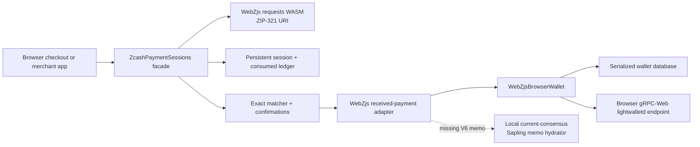
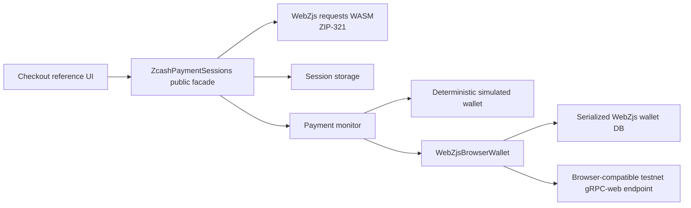

# Zcash Payment Sessions

Zcash Payment Sessions is a browser SDK that turns a ZIP-321 payment request into a persistent,
replay-safe payment lifecycle.

```text
AWAITING_PAYMENT -> DETECTED -> CONFIRMING -> PAID
```

ZIP-321 tells a wallet what to pay. An application still needs to know whether the exact payment
arrived, whether its amount and memo match, whether it has enough confirmations, whether the
request expired, whether it was already consumed, and whether the result survives a reload.

The SDK provides ZIP-321 request generation through WebZjs, persistent payment sessions, exact
amount and memo correlation, stable `txid + pool + output index` identities, confirmation
progression, expiry, reorg-safe states, local current-consensus Sapling memo hydration, a
consumed-payment ledger, duplicate-credit prevention, and cross-session replay protection.

## Public SDK in one minute

The integration uses only the package facade. Wallet creation and transport setup are application
responsibilities; a WebZjs-compatible wallet adapter supplies received payments to `refresh()`.

```ts
import { ZcashPaymentSessions } from "zcash-payment-sessions";

const sdk = await ZcashPaymentSessions.create({
  storage: localStorage,
  recipientAddress: "ztestsapling1...",
  wallet: webzjsWallet,
  accountId: 1,
  requiredConfirmations: 2
});

const session = await sdk.createSession({
  amountZatoshis: 10_000n,
  memo: "order-123",
  expiresInMs: 2 * 60 * 60 * 1000
});

console.log(session.paymentUri); // render as a QR or copyable ZIP-321 URI
const result = await sdk.refresh(session.id);
console.log(result.session?.status, result.observation.outcome);
```

The public surface also exports `WebZjsBrowserWallet`, `createSaplingMemoHydrator`,
`decodeZip321Uri`, `proposeZip321Transfer`, and the public observation/session types.

## Architecture



## Judge-first links

- [Public GitHub repository](https://github.com/Iniwura/zcash-payment-sessions)
- [Interactive checkout and product site (Vercel)](https://zcash-payment-sessions.vercel.app/)
- [Fallback reference checkout (GitHub Pages)](https://iniwura.github.io/zcash-payment-sessions/)
- [Live testnet proof](LIVE_TESTNET_PROOF.md)
- [Threat model and limitations](docs/THREAT_MODEL.md)
- [Three-minute reviewer guide](docs/REVIEWER_GUIDE.md)
- [Reference checkout source](examples/checkout)

On the isolated Vercel deployment, the checkout opens in **Real testnet** mode. Connect a
dedicated Zcash testnet view-only wallet using its UFVK and account birthday, then create a
ZIP-321 request and sync to observe real chain data. The public Render gRPC-Web gateway is
preconfigured; a real payment still requires a funded sender and live verification. No seed,
spending key, or private key is accepted. The separate **Developer simulation** mode exercises
lifecycle states without sending any funds.

The public GitHub Pages build cannot provide COOP/COEP headers, so it keeps deterministic simulation
fully enabled and gates Real testnet mode. Real testnet mode remains available from a self-hosted
deployment with those headers; see the [verified live testnet proof](LIVE_TESTNET_PROOF.md).

## Reproducible WebZjs setup

The repository does not depend on a sibling checkout or on published WebZjs packages. The
bootstrap script creates an ignored `.deps/WebZjs` checkout at the exact pinned commit, applies
the tracked compatibility patches, builds only `webzjs-keys`, `webzjs-requests`, and
`webzjs-wallet`, verifies the generated package names and versions, and installs the local
runtime packages with `npm ci`.

Prerequisites:

- Node.js `22.12.0` or newer (the current Vitest release requires Node 22.12+, 24.x, or 26.x)
- npm
- Git
- `clang`
- `just`
- `wasm-pack`
- `rustup` and `cargo`
- Rust nightly `nightly-2025-01-07` with `wasm32-unknown-unknown` and `rust-src`
- Rust stable `1.89.0` with `wasm32-unknown-unknown` for the current-consensus hydrator

The script never changes the global Rust default and never invokes `sudo`. If a prerequisite is
missing, it stops with the exact local installation command to run.

From a clean clone:

```sh
npm run bootstrap:webzjs
```

The source patches are [patches/webzjs-wallet-received-payments.patch](patches/webzjs-wallet-received-payments.patch)
and [patches/webzjs-wallet-memo-transfer.patch](patches/webzjs-wallet-memo-transfer.patch), plus
[patches/webzjs-wallet-raw-transaction.patch](patches/webzjs-wallet-raw-transaction.patch). The
first adds the exact received-output API needed by the payment matcher. The second adds only the
testnet proof tooling's `propose_transfer_with_memo` method; the stock WebZjs
`propose_transfer` method remains memo-less. The ZIP-321 sender adapter parses the URI with the
generated requests package and passes the exact memo bytes to that additive method. The pinned
WebZjs checkout remains untracked and disposable. Generated WASM artifacts are intentionally not
committed.

When compact WebZjs observations do not contain a memo because the pinned transaction parser
cannot decode a newer consensus transaction, the public adapter can be given
`createSaplingMemoHydrator(...)`. It fetches complete bytes through WebZjs `get_transaction` and
uses the separately built browser-compatible `wasm/sapling-memo-hydrator` module. The hydrator is
opt-in, performs no transaction parsing in TypeScript, and only returns evidence after exact
transaction/output/value checks. Build it with `bash scripts/build-sapling-memo-hydrator.sh`;
it uses stable Rust 1.89 and the current-consensus librustzcash revision recorded in its manifest.
See [LIVE_TESTNET_PROOF.md](LIVE_TESTNET_PROOF.md) for the verified V6 testnet evidence and the
expired-session outcome.

To verify the checkout without rebuilding it:

```sh
npm run verify:reproducibility
```

The generated developer-only keys package is `@chainsafe/webzjs-keys@0.1.0`. The generic helper
`scripts/derive-testnet-ufvk.mjs` uses Node OS randomness for a caller-provided 32-byte seed file,
constructs the pinned WebZjs testnet key API, and prints only the resulting `uview...` UFVK:

```sh
node scripts/derive-testnet-ufvk.mjs <path-to-testnet-seed.bin>
```

It never calls WebZjs `generate_seed_phrase()` and is not a runtime dependency of the checkout.
Keep any testnet seed outside the repository with restrictive permissions.

## Development

```sh
npm run build
npm test
npm run typecheck
npm run test:consumer
```

The package facade is emitted to `dist/` and is exposed through the package `exports` map. The
consumer smoke test imports the built package by name, matching third-party consumption rather
than importing source internals.

## Reference checkout

The repository includes a small browser checkout at `examples/checkout`. It is deliberately
frontend-only: the checkout controller imports the package facade, creates a ZIP-321 URI, passes
that exact URI to the maintained `qr` encoder, and renders the payment-session state machine.



Prepare and build the reference app from a clean checkout:

```sh
npm run bootstrap:webzjs
npm ci
npm run build
npm run demo:typecheck
npm run demo:build
npm run demo:dev
```

The default mode on the cross-origin-isolated Vercel deployment is real TESTNET, not simulation.
It requires a view-only UFVK and wallet birthday before a request can be created. On GitHub
Pages, where COOP/COEP headers are unavailable, real mode is gated and Developer simulation
is selected instead. Simulation demonstrates detection, confirmation progression,
duplicate refreshes, ambiguity, reorg, expiry, QR rendering and restoration without funds.

Real mode is testnet-only. The reference app defaults to
`https://zps-testnet-gateway.onrender.com`, a free Envoy gRPC-Web gateway to a public
testnet lightwalletd server. It can be overridden with another verified browser-compatible
proxy. The gateway can sleep while idle and is not guaranteed to be continuously available. A raw lightwalletd gRPC endpoint is not
interchangeable with the browser gRPC-web transport. The first view-only account import requires a
user-provided testnet UFVK and an explicit account birthday height; no birthday is invented and no
full-chain scan is started implicitly. The imported view-only wallet database is serialized
through WebZjs `db_to_bytes()` and stored under a separate browser-storage key; the UFVK input is
cleared after the wallet is opened, including initialization failures. No seed or private key
is accepted or logged. A UFVK can reveal payment history and must be treated as private viewing
material; use a dedicated testnet-only wallet.

The browser adapter uses only the generated WebZjs public package. On first open it initializes
the generated wallet WASM and its worker pool once, restores the serialized database if present,
and exposes sync, current-address, view-only-account, and received-payment operations. The
generated package is `@chainsafe/webzjs-wallet@0.1.0`; ZIP-321 generation comes from the pinned
`@chainsafe/webzjs-requests@0.1.0` package. Both packages are built locally from the pinned
WebZjs commit and remain ignored build artifacts.

The Vite dev and preview servers send `Cross-Origin-Opener-Policy: same-origin` and
`Cross-Origin-Embedder-Policy: require-corp`. These headers are required for the generated WebZjs
worker pool and `SharedArrayBuffer`; without them the browser wallet cannot initialize.

The app is a reference implementation rather than a claim of a live testnet payment. Configure a
verified endpoint, import a testnet UFVK, and fund a testnet account before exercising real sync
and matching.

## License

MIT. See [LICENSE](LICENSE).

## Experimental public testnet transport

The free testnet gRPC-Web gateway at `https://zps-testnet-gateway.onrender.com` has returned a successful `GetLightdInfo` response and the full historical shielded transaction at block `4490144`. A real browser also opened an ephemeral view-only testnet account, created a valid ZIP-321 request, and synchronized through the gateway. **These tests do not replace a new funded payment proof in the public checkout.** The checkout's experimental real testnet mode pre-fills this endpoint and loads the isolated current-consensus Sapling memo WASM from the same origin.

To build this browser checkout locally, build both WebZjs and the hydrator first:

```sh
npm run bootstrap:webzjs
bash scripts/build-sapling-memo-hydrator.sh
npm run demo:build
```

A testnet UFVK is required each time the wallet is opened so the memo hydrator can decrypt Sapling outputs locally. The checkout does not persist an additional plaintext UFVK; the underlying view-only wallet database remains in local browser storage. A viewing key grants access to payment information, so use a dedicated throwaway testnet account. Never enter a spending key or mainnet viewing key. A correct real-payment lifecycle and memo matching still require live transaction verification; they are **not yet established by the public gateway test**.

## Merchant-first wallet onboarding (feature branch)

The checkout supports a merchant-specific, **optional encrypted viewing profile**. The merchant connects a testnet Unified Full Viewing Key and birthday once. If they provide a separate passphrase (minimum 12 characters), the view-only key and gateway settings are encrypted locally with Web Crypto PBKDF2-SHA256 (310,000 iterations) and AES-256-GCM, then stored as ciphertext in that browser. On return, the merchant unlocks that locally encrypted profile with their passphrase; the WebZjs view-only wallet database lives in **volatile browser memory**, while payment-session metadata is stored separately. This prevents the serialized WebZjs database (which can contain viewing material) from being saved unencrypted in localStorage. Unlocking after a page reload recreates the wallet from the saved encrypted viewing key and birthday and may require rescanning blocks. No spending key, seed or mnemonic is accepted. Passphrase recovery is unavailable, and a compromised browser can still expose viewing data while unlocked. Older deployments may already have `wallet:testnet:db` in browser localStorage; users should remove that legacy item manually before treating their local storage as private.

This is **not** a standard Zcash injected-wallet integration and not server-side monitoring. The customer only needs to scan or follow the ZIP-321 payment URI. The reference merchant tab must remain open for manual refresh and on-chain observations. A separate signed payment from an external testnet wallet remains necessary to establish new live checkout settlement.
