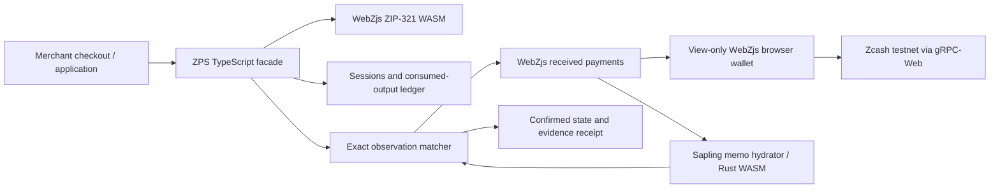

# Zcash Payment Sessions

**A reusable TypeScript SDK for verifiable Zcash payment checkouts.**

ZIP-321 can tell a wallet *what to pay*. It does not tell an application whether the intended shielded payment was received, whether it belongs to this order, whether it has enough confirmations, or whether the same output was already used to credit another order.

**Zcash Payment Sessions (ZPS) provides that missing application layer:** generate a ZIP-321 request, track a durable payment session, correlate observed Zcash outputs by exact amount and memo, handle confirmations and explicit reorganizations, and refuse ambiguous or duplicate settlement.

Built for **ZECATHON 2026 · Core & Tooling**. The deliverable is the **SDK**; the public merchant checkout is a working reference implementation, not a custodial payment processor.

| Explore | Link |
| --- | --- |
| **Try the reference checkout** | **[Open ZPS on Vercel](https://zcash-payment-sessions.vercel.app/checkout)** |
| **Evaluate in three minutes** | [Judge/reviewer walkthrough](docs/REVIEWER_GUIDE.md) |
| **Inspect an actual paid testnet session** | [Recorded on-chain payment and SDK lifecycle](LIVE_TESTNET_PROOF.md) |
| **Understand the trust boundaries** | [Threat model](docs/THREAT_MODEL.md) · [Documentation index](docs/INDEX.md) |
| **Inspect the implementation** | [SDK source](src/index.ts) · [Reference app](examples/checkout/) · [Tests](tests/) |

> **Evidence distinction:** A historical funded Zcash **testnet** transaction reached `PAID` through the real SDK (recorded October 11, 2026). The current Vercel checkout has also opened a real view-only testnet wallet, generated a ZIP-321 request, and synchronized against the testnet gateway in browser acceptance tests. **A separate newly funded payment through the current public Vercel checkout has not been demonstrated.** Developer simulation is clearly labeled and never presented as on-chain settlement.

## The problem

Accepting shielded Zcash payments creates several application-specific responsibilities beyond producing a payment URI:

| Requirement | Why a payment URI alone is insufficient | ZPS behavior |
| --- | --- | --- |
| Payment correlation | Two orders can use the same amount | Requires the intended amount **and memo** |
| Output identity | A transaction can have multiple outputs | Identifies an output by transaction ID, pool, and output index |
| Finality policy | Detection is not the same as confirmation | Tracks confirmation depth before `PAID` |
| Idempotency | Repeated scans or page reloads must not credit twice | Persists a session match and consumed-payment ledger |
| Concurrency | Two tabs can race to claim one payment | Requires an atomic claim operation; otherwise fails closed |
| Failure handling | Missing metadata or RPC errors are not proof of a reorg | Keeps the last trusted state; exposes incomplete/unavailable results |
| Chain reorganizations | Previously observed payment evidence can be invalidated | Handles **explicit** reorg evidence and eligible replacement payments |
| Expiration and ambiguity | Late or multiple matches cannot be silently accepted | Explicit `EXPIRED` / `AMBIGUOUS` behavior |

This makes ZPS useful as infrastructure for merchant checkouts, invoices, donations, subscriptions, and other applications that need to **reconcile a shielded payment with an intended request**.

## What is implemented

- **ZIP-321 request generation** using the pinned WebZjs requests WASM package, including exact amount and memo.
- **Stateful sessions** with creation, expiry, serialization, restoration, and validated transitions.
- **Payment observation and matching** using WebZjs wallet received-output data; exact memo and zatoshi amount are required.
- **Confirmation-aware settlement**: `AWAITING_PAYMENT → DETECTED → CONFIRMING → PAID`.
- **Replay and duplicate protection** through a persistent consumed-output ledger and atomic claim contract.
- **Explicit exceptional states**: `EXPIRED`, `AMBIGUOUS`, and `REORGED`; incomplete observations and transient errors do not fabricate finality.
- **Current-consensus Sapling memo compatibility** via a separate browser-compatible Rust/WASM hydrator for full transaction data that the pinned WebZjs parser cannot interpret.
- **View-only reference wallet** in the browser, testnet gateway connectivity, optional locally encrypted merchant profile, and a real ZIP-321 QR.
- **A separated developer simulation** for inspecting success, failure, ambiguity, replay, expiry, and reorg behavior without moving funds.
- **Evidence-based receipts** visible only when the checkout's SDK session is `PAID` with exact payment evidence; simulated receipts explicitly say they are simulated.

### Session model

```text
AWAITING_PAYMENT ──exact output──▶ DETECTED ──confirmations──▶ CONFIRMING ──threshold──▶ PAID
       │                               │                           │                      │
       └──────────expiry───────────────┴───────────expiry──────────┘                      │
                                                               explicit chain reorg ◀─────┘
                                                                     │
                                                                  REORGED
                                                                     │
                                                         eligible replacement observation
```

The state machine also represents ambiguity and invalid transitions. The diagram is a conceptual overview; authoritative behavior and allowed transitions live in [`src/session.ts`](src/session.ts) and [`src/monitor.ts`](src/monitor.ts).

## Quick evaluation: choose one of two honest paths

### A. Developer simulation — no wallet or funds

1. Visit **[the checkout](https://zcash-payment-sessions.vercel.app/checkout)** and select **Developer simulation**.
2. Choose an example order or enter an amount and unique correlation memo.
3. Use the **guided payment walkthrough** to create the request, display its ZIP-321 URI and QR, and observe SDK states.
4. Inspect the **simulated** receipt, refresh the page, and explore the edge-case scenarios.
5. Confirm the UI always identifies this mode as simulation. No testnet payment has occurred in this path.

This is the fastest way to evaluate **SDK behavior and product UX**; it is **not** proof of a funded transaction.

### B. Real Zcash testnet — real view-only observation

1. Open the **[Vercel checkout](https://zcash-payment-sessions.vercel.app/checkout)** in a browser that supports cross-origin isolation. Select **Real testnet**.
2. Use a **dedicated testnet wallet** capable of exporting a Unified Full Viewing Key (UFVK). Enter its **viewing key** and **wallet birthday height**. Never enter a seed, mnemonic, or spending key.
3. Keep the preconfigured **testnet gRPC-Web gateway**, or choose a compatible endpoint under the advanced connection settings.
4. **Connect view-only wallet**; on first use, initialization and scanning can take time. Optionally protect the viewing profile with a passphrase of at least 12 characters for later local unlock.
5. Create the request. The QR encodes the original ZIP-321 payment URI; **a QR is a request, not payment evidence**.
6. A **separate funded testnet sender** must actually pay the request. Refresh the merchant view to observe the chain and advance the session as verified evidence becomes available.

A returning merchant can unlock the previously encrypted viewing profile in the **same browser profile**. The WebZjs working wallet database remains **volatile**; returning may require another scan. Customers do **not** provide a viewing key: they scan the merchant's request with a compatible wallet.

**Browser note:** WebZjs requires `Cross-Origin-Opener-Policy: same-origin`, `Cross-Origin-Embedder-Policy: require-corp`, WASM workers, and `SharedArrayBuffer`. The Vercel checkout serves these headers; interfering browser extensions or an environment without isolation can disable real testnet mode. GitHub Pages is a **simulation-only fallback** because those required headers are unavailable there.

## Independent evidence, not simulated claims

| Evidence | What it establishes | What it does **not** establish |
| --- | --- | --- |
| [Historical on-chain payment](LIVE_TESTNET_PROOF.md) | A real funded testnet transaction, local current-consensus Sapling memo recovery, exact matching, confirmation progression to `PAID`, reload survival, and second-session replay rejection | A newly funded payment through the present Vercel checkout |
| [Browser real-testnet integration](.github/workflows/verify-live-testnet-checkout.yml) | Real view-only WebZjs wallet initialization, ZIP-321 request/QR generation, gateway sync, and merchant profile unlock/reload | A signed or broadcast payment |
| [Merchant and security checks](.github/workflows/verify-merchant-integration.yml) | The real browser onboarding, request, sync and storage behavior under automated acceptance | Full real-world availability or mainnet readiness |
| [Unit and adversarial tests](tests/) | Payment state transitions, malformed inputs, replay races, expiry, reorg handling and SDK integration | A public hosted backend or custody service |

**Recorded funded testnet proof (October 11, 2026)**

| Field | Observed value |
| --- | --- |
| Amount | **10,000 zatoshis** (0.0001 testnet ZEC / TAZ) |
| Canonical transaction ID | [`81c9ae83cede34ca8b47cac1f60c7327651173fdf2c97a1af908561b126c7cfc`](LIVE_TESTNET_PROOF.md) |
| Block | `4,490,144` |
| Confirmations at observation | `90` |
| Session | `50fd77e4-34bd-4508-b651-578e14f121cb` |
| SDK lifecycle | `AWAITING_PAYMENT → DETECTED → CONFIRMING → PAID` |
| Repeated-credit attempt | `ALREADY_CONSUMED` for the same output on another session |

The [proof record](LIVE_TESTNET_PROOF.md) includes the request, memo, transaction identity, recorded browser/adapter compatibility findings, reload evidence, and the difference between canonical and raw transaction ID byte order.

## SDK integration

The SDK is an ESM TypeScript package with its public entrypoint in [`src/index.ts`](src/index.ts). It is designed to be embedded into an existing Zcash application; it does **not** create spending keys, manage customer payments, or supply a hosted wallet account.

```ts
import { ZcashPaymentSessions } from "zcash-payment-sessions";

// Supply your own compatible view-only wallet and storage implementation.
// For crediting, storage.claimItem(key, sessionId) MUST be atomic.
const sdk = await ZcashPaymentSessions.create({
  storage: paymentStorage,
  wallet: webzjsWallet,
  accountId: 0,
  recipientAddress: "ztestsapling1...", // replace with your real testnet recipient
  requiredConfirmations: 2
});

const session = await sdk.createSession({
  amountZatoshis: 10_000n,
  memo: "order-123",
  expiresInMs: 20 * 60 * 1000
});

// Present session.paymentUri as a QR code or a copyable ZIP-321 URI.
// After synchronizing the wallet and receiving an external payment:
const result = await sdk.refresh(session.id);
console.log(result.session?.status, result.observation.outcome);
```

`paymentStorage` and `webzjsWallet` are intentionally application-supplied objects, not built-in globals. The [reference checkout](examples/checkout/src/main.ts) provides a complete browser adapter and controller showing how to wire them up.

### The atomic storage rule

For **payment crediting**, `storage` must implement `claimItem(key, owner)` with a single atomic claim: return `null` when this writer wins or the **existing owner's ID** when already claimed. It may return a promise. A non-atomic check-then-set is unsafe.

- **One browser origin / multiple tabs:** the reference implementation uses **Web Locks** with same-origin browser storage.
- **Multiple devices / server workers:** use a **shared transactional datastore** with a uniqueness constraint or equivalent atomic primitive.
- **No atomic claim capability:** ZPS returns `CONCURRENCY_UNSUPPORTED` rather than crediting an output.

Read [`src/storage.ts`](src/storage.ts), [`src/monitor.ts`](src/monitor.ts) and [`docs/THREAT_MODEL.md`](docs/THREAT_MODEL.md) for the exact contract and failure modes.

### Architecture



**Why the separate hydrator?** The pinned WebZjs wallet parser cannot decode all current-consensus V6 transaction formats, so compact observations may omit the Sapling memo needed for correlation. The [Rust/WASM hydrator](wasm/sapling-memo-hydrator/) processes full transaction bytes locally, and binds its result back to the correct transaction, output, recipient and value. This is an **explicit compatibility layer**, not a claim that WebZjs supports every current Zcash transaction format. [More detail](docs/THREAT_MODEL.md#consensus-compatibility).

## Repository guide

```text
src/                      Public SDK, wallet adapter, matcher, session and storage
tests/                    Unit, integration, adversarial and compatibility tests
examples/checkout/        Vercel reference checkout, wallet onboarding, QR, receipts and tour
wasm/sapling-memo-hydrator/  Rust current-consensus Sapling evidence module
gateway/                  Optional free testnet gRPC-Web / Envoy proxy
patches/                  Auditable compatibility patches for pinned WebZjs
scripts/                  Reproducible builds, smoke checks and testnet utilities
docs/                     Reviewer walkthrough, security model and technical records
.github/workflows/        Build, security, live-testnet and deployment verification
LIVE_TESTNET_PROOF.md     Recorded real testnet payment evidence
```

### Reproducible setup

This source tree intentionally does **not** commit generated WebZjs/WASM packages or secrets. The bootstrapping script checks out **ChainSafe/WebZjs at `a50df944c32243cb8da9f86e7d52cb65ac926439`**, applies the three [tracked compatibility patches](patches/), builds the required packages, and installs dependencies.

**Prerequisites:** Node.js 24.x recommended (22.12+ supported), npm, Git, clang, Rust/Cargo, `just`, `wasm-pack`, Rust `nightly-2025-01-07` with `rust-src` / `wasm32-unknown-unknown`, and stable Rust 1.89 with the WASM target for the hydrator. The bootstrap script checks prerequisites without silently installing system tools or changing the global Rust default.

```sh
git clone https://github.com/Iniwura/zcash-payment-sessions.git
cd zcash-payment-sessions

npm run bootstrap:webzjs
bash scripts/build-sapling-memo-hydrator.sh

npm run typecheck
npm run build
npm test
npm run test:consumer
npm run verify:reproducibility
npm run demo:typecheck
npm run demo:build
```

To inspect the local reference app:

```sh
npm run demo:dev
```

The build and test commands use the pinned WebZjs dependencies built by the bootstrap step. Running `npm ci` alone before those local dependencies exist is insufficient for a clean clone. For instructions on the Render gateway, see [`gateway/README.md`](gateway/README.md).

### Automated release evidence

Source and docs are tracked in `main`. Compiled deployable frontend assets are assembled by [`deploy-demo.yml`](.github/workflows/deploy-demo.yml) and published to a separate generated `vercel-static` branch. Direct Vercel source builds are intentionally skipped. The release pipeline checks the SDK, consumer import, browser checkout, real view-only wallet synchronization, and public asset integrity. Inspect the [Actions history](https://github.com/Iniwura/zcash-payment-sessions/actions) for the exact commit and results.

## Privacy, security and limits

**Noncustodial by design.** ZPS does not request or use seeds, spending keys or mnemonics. The reference wallet accepts a **view-only testnet UFVK**, which is still sensitive because it reveals activity. Trial decryption for Sapling memo evidence happens locally. Payment sessions and correlation memos are application metadata and should be stored with appropriate privacy controls.

**Optional encrypted profile.** If enabled, the merchant's viewing profile is encrypted locally using PBKDF2-SHA256 and AES-256-GCM, protected by a user-supplied passphrase. The active WebZjs working database is **volatile**, not a plaintext persistent database. Unlock may require a rescan. There is no account recovery service.

**Transport is not a trust oracle.** The free public testnet Envoy gateway translates browser gRPC-Web to the upstream lightwalletd endpoint. It can cold-start, has free-tier limits, and can learn which transaction is requested during full-transaction hydration. For stronger privacy or reliability, connect to a trusted or self-hosted endpoint. Arbitrary HTTPS does not imply an honest Zcash server.

**What this project is not:**

- Not a mainnet-ready custodial processor, wallet, signing service or automatic background payment watcher.
- Not a push-payment or transaction broadcasting service: the customer uses an external wallet.
- Not a production cross-device settlement ledger: the reference checkout's atomic claims cover **same-origin tabs**, not independent devices.
- Not a claim of newly funded end-to-end **public Vercel checkout** settlement; our historic real payment is documented separately.
- Not an invisible chain indexer: real mode requires a merchant's view-only wallet, explicit birthday height, and manual refresh in an active browser.
- Not a general solution to browser compromise, dishonest upstream RPC services, or leakage of viewing metadata.

The browser deployment uses COOP/COEP and CSP compatible with WebZjs, including `'unsafe-eval'` in `script-src` because the current worker bundle needs it. This is a deliberate compatibility/security trade-off for the experimental testnet reference, not a recommended universal production CSP. The [threat model](docs/THREAT_MODEL.md) explains the full boundary.

## Roadmap

The natural next integrations are a documented adapter for a shared transactional backend, more convenient standards-based merchant wallet provisioning, richer real-testnet observability, and a production transport/privacy review. Those are **future work**, not features claimed to exist today.

## License and attribution

**MIT licensed.** See [LICENSE](LICENSE). The project uses [ChainSafe WebZjs](https://github.com/ChainSafe/WebZjs) via a **pinned source checkout and explicit local patches**; the current-consensus Sapling hydrator is built separately from its Rust sources. Refer to individual dependencies for their licenses and upstream provenance.

---

**The central promise is narrow and testable:** given a ZIP-321 request and trustworthy received-payment evidence, applications can turn shielded Zcash payments into persistent, exact, replay-aware session outcomes instead of inferring success from a QR code or a transaction hash.
